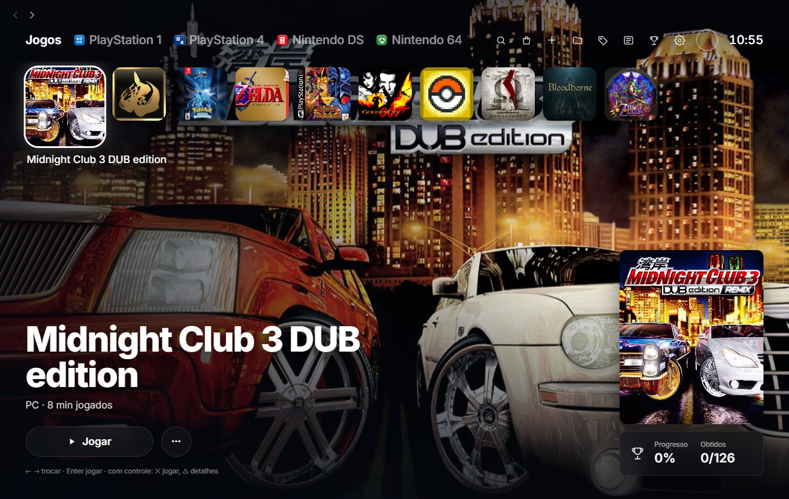
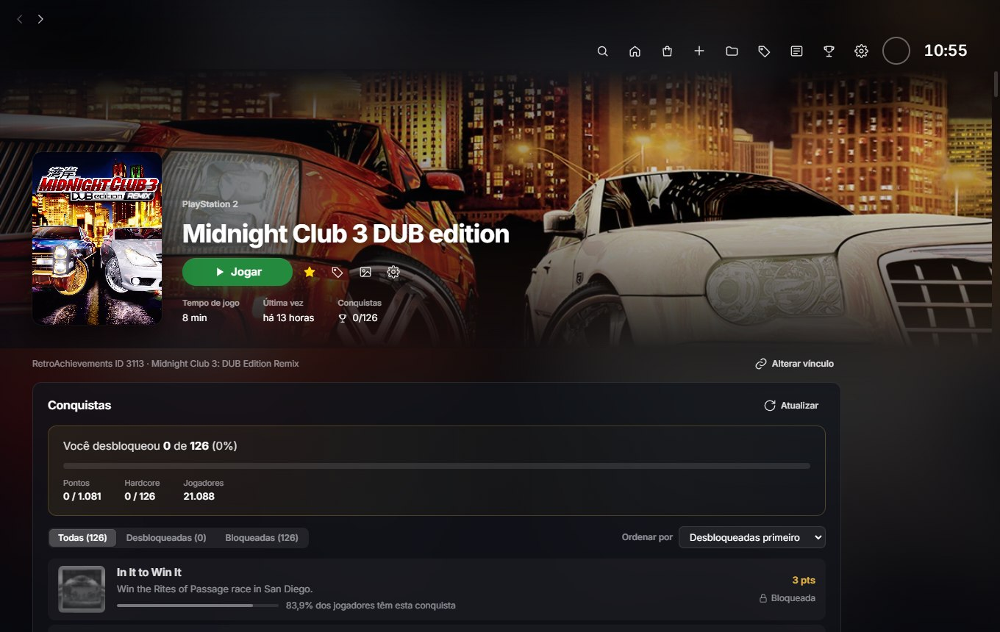
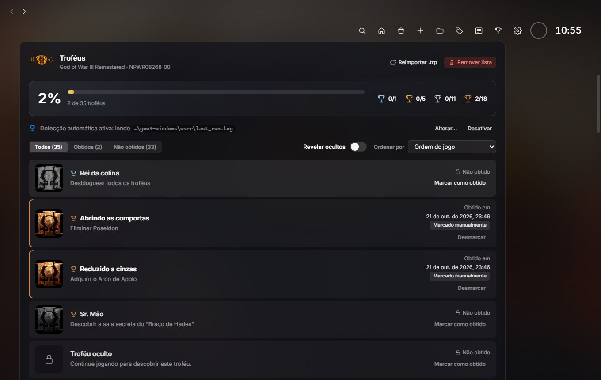
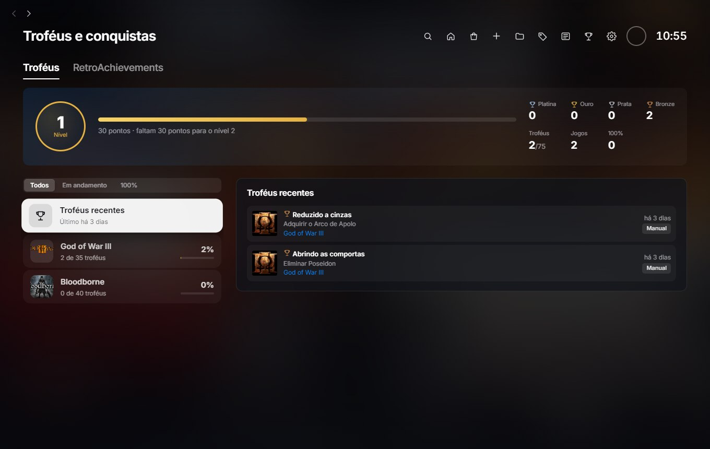
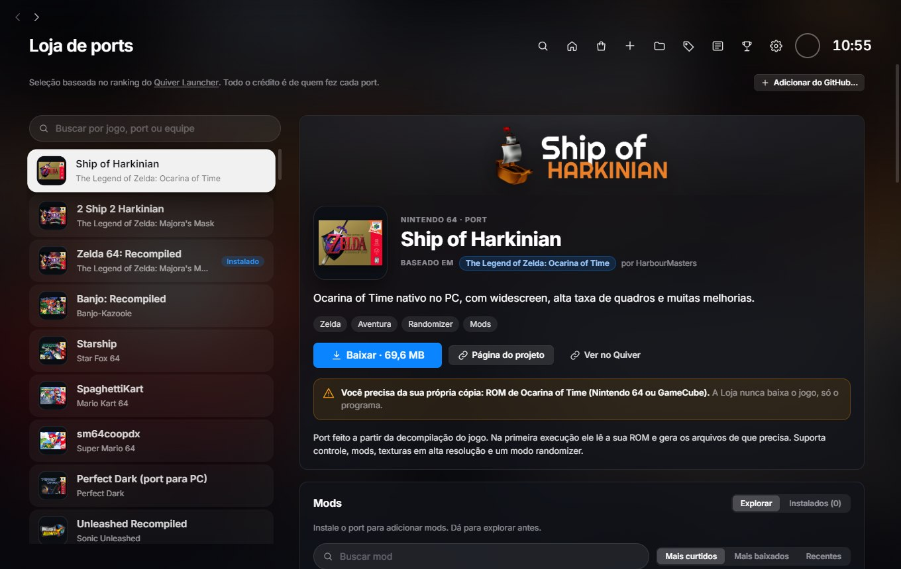
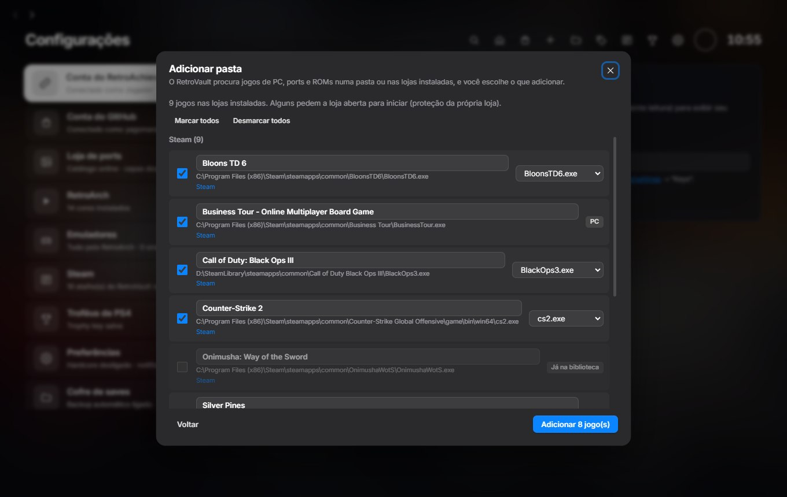
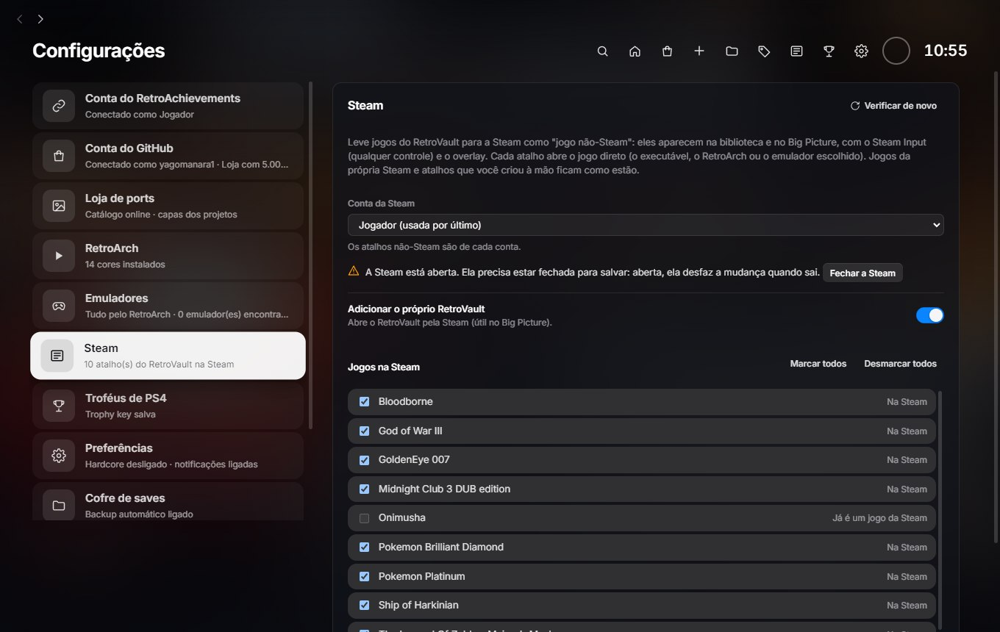
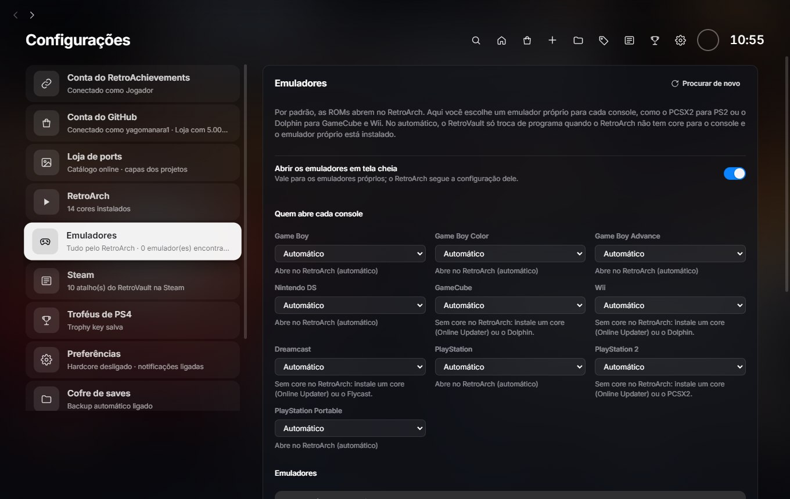
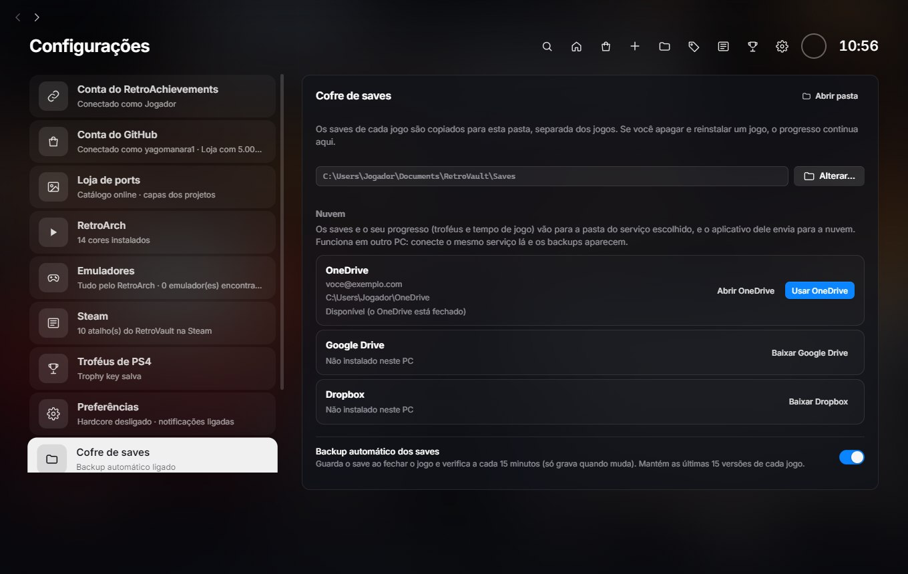

# RetroVault

Launcher para Windows no estilo dos consoles. Junta numa biblioteca só os seus jogos de PC, ports, ROMs de
emuladores e os jogos das lojas que você já tem (Steam, Epic, GOG…), com conquistas do RetroAchievements,
troféus, cofre de saves na nuvem e uma **Loja de ports** de código aberto.

**[⬇ Baixar a versão mais recente](https://github.com/yagomanara1/retrovault/releases/latest)**: baixe o arquivo
`RetroVault-Setup-<versão>.exe`. Windows 10 ou 11, 64 bits. Grátis, sem conta e sem anúncios.



## Sumário

- [Biblioteca](#biblioteca)
- [Página do jogo e conquistas](#página-do-jogo-e-conquistas)
- [Troféus](#troféus)
- [Loja de ports](#loja-de-ports)
- [Adicionar jogos e importar das lojas](#adicionar-jogos-e-importar-das-lojas)
- [Steam](#steam)
- [Emuladores](#emuladores)
- [Saves e nuvem](#saves-e-nuvem)
- [Mais recursos](#mais-recursos)
- [Instalar](#instalar) · [Primeiros passos](#primeiros-passos) · [Desinstalar](#desinstalar)
- [Segurança e privacidade](#segurança-e-privacidade) · [Código aberto](#código-aberto) · [Créditos](#créditos)

## Biblioteca

- **Tela inicial de console:** a fileira de jogos no topo, com a arte do jogo escolhido ocupando a tela. Funciona
  com mouse, teclado ou **controle** (✕ joga, △ abre os detalhes).
- **Categorias por console:** PlayStation, Nintendo DS, Nintendo 64… criadas e preenchidas sozinhas. Dá para
  criar as suas, escolher ícones e reordenar.
- **Favoritos, busca e tempo de jogo:** o tempo conta enquanto o jogo estiver aberto, mesmo quando ele abre
  outro programa por trás (launchers de ports).
- **Capas automáticas:** do RetroAchievements, do próprio jogo ou do [SteamGridDB](https://www.steamgriddb.com/).
  Você pode buscar outras opções ou enquadrar a sua imagem.
- **Jogo mudou de pasta?** O RetroVault procura o novo local sozinho, ou você aponta o arquivo.

## Página do jogo e conquistas



- **Conquistas do [RetroAchievements](https://retroachievements.org):** a lista do jogo com o seu progresso,
  pontos, raridade e quantos jogadores têm cada uma. Durante o jogo, cada conquista desbloqueada vira uma
  notificação do Windows.
- **Identificação automática:** ao adicionar uma ROM, o RetroVault calcula a assinatura dela (o mesmo método do
  RetroAchievements) e vincula o jogo certo. Funciona com cartuchos (inclusive dentro de `.zip`), Nintendo DS e
  imagens de disco (`.iso`, `.bin/.cue`, `.cso`, `.pbp`, `.m3u`) de PlayStation 1, 2 e Portátil, Sega CD e Saturn.
- **Modo Hardcore:** opcional, para as conquistas valerem pontos Hardcore.

## Troféus





- **Ports de PS4:** os troféus vêm do próprio jogo (`trophy00.trp`) e são marcados sozinhos durante a partida,
  quando o port registra o desbloqueio.
- **PlayStation 3 (RPCS3) e PS Vita (Vita3K):** os troféus que o emulador guarda aparecem no RetroVault, com aviso
  na hora em que você ganha.
- **Nível e estatísticas:** platina, ouro, prata e bronze somados num nível, como no console, com os troféus recentes.
- Você também pode marcar troféus à mão.

## Loja de ports



- **Ports e recompilações de código aberto** (Zelda, Mario, Sonic, Perfect Dark…) que instalam com um clique e
  entram na biblioteca já com capa.
- **Os jogos não vêm junto:** cada port pede a sua própria cópia (ROM ou arquivos do jogo), e a página diz qual.
- **Direto do projeto original:** o RetroVault baixa o programa do GitHub de quem fez o port e confere o arquivo.
  Projetos gerados por IA vêm sinalizados.
- **Atualizações dos ports:** avisa quando sai versão nova e atualiza mantendo saves, configurações e mods (o
  save também vai para o cofre antes, por garantia).
- **Mods do [GameBanana](https://gamebanana.com/):** explore e instale mods de cada port pela própria Loja.
- **Adicionar do GitHub:** cole o endereço de um repositório para incluir um port que não está no catálogo.

## Adicionar jogos e importar das lojas



- **Um jogo:** escolha o `.exe`, atalho ou ROM.
- **Uma pasta inteira:** o RetroVault encontra os jogos de PC, ports e ROMs e mostra a lista para você revisar
  (nome, executável principal) antes de adicionar.
- **Importar das lojas instaladas:** **Steam, Epic Games, GOG, Ubisoft Connect, Amazon Games e itch.io**. Só lê
  o que cada loja já guarda no PC, sem login e sem mexer nelas.
- **Jogos da Steam continuam abrindo pela Steam** (DRM, nuvem e conquistas dela funcionam) e chegam com capa,
  fundo e o tempo de jogo que a Steam já registrou.

## Steam



- **Leve seus jogos do RetroVault para a Steam** como "jogo não-Steam": eles aparecem na biblioteca e no
  **Big Picture**, com **Steam Input** (qualquer controle) e overlay, já com capa, fundo e ícone.
- **Você escolhe a conta e os jogos.** A Steam precisa estar fechada para salvar (há um botão para fechá-la).
- **Os atalhos que você mesmo criou na Steam nunca são alterados**, e o arquivo anterior é copiado antes de cada
  mudança. Desmarcar tudo devolve a Steam como estava.

## Emuladores



- As ROMs abrem no [RetroArch](https://www.retroarch.com/) por padrão.
- Para cada console, dá para usar um **emulador próprio**: DuckStation, PCSX2, PPSSPP, Dolphin, melonDS, mGBA
  ou Flycast. O RetroVault os encontra nas pastas de instalação, ou você indica o `.exe`.
- **No automático**, ele só troca de programa quando o RetroArch não tem core para o console e o emulador próprio
  está instalado.

## Saves e nuvem



- **Cofre de saves:** o save de cada jogo é copiado para uma pasta separada ao fechar o jogo e a cada 15 minutos
  (só quando muda), guardando as **últimas 15 versões**. Apagou o jogo? O progresso continua lá.
- **Restaurar uma versão** com um clique, na página do jogo.
- **Nuvem:** coloque o cofre numa pasta do **OneDrive, Google Drive ou Dropbox** e os saves, troféus e tempo de
  jogo vão junto para os outros PCs.
- **Backup da biblioteca** diário, com exportar e importar o progresso.

## Mais recursos

- **Discord:** mostra no seu perfil o jogo que você está jogando, a plataforma e há quanto tempo (pode desligar).
- **Atualiza sozinho:** quando sai uma versão nova, baixa em segundo plano e pergunta se pode reiniciar.
- **Leve:** os dados ficam no seu PC; nada de conta própria nem servidor do RetroVault.

## Instalar

1. Baixe o `RetroVault-Setup-<versão>.exe` na página de [versões](https://github.com/yagomanara1/retrovault/releases/latest).
2. Abra o arquivo. Na primeira vez, o Windows pode mostrar a tela azul **"O Windows protegeu o computador"**.
   Isso acontece porque o instalador não tem assinatura digital paga. Clique em **Mais informações → Executar assim mesmo**.
3. Escolha a pasta (ou deixe a sugerida) e conclua. Não pede senha de administrador: instala só para o seu usuário.

## Primeiros passos

1. **Adicione seus jogos:** botão de pasta no topo → **Escolher pasta…** ou **Importar das lojas instaladas**.
2. **Para ROMs:** instale o [RetroArch](https://www.retroarch.com/) e os cores dos consoles (no RetroArch:
   Online Updater → Core Downloader).
3. **Para conquistas:** em **Configurações → Conta do RetroAchievements**, informe seu usuário e a Web API Key
   (em [retroachievements.org/settings](https://retroachievements.org/settings) → Keys). No RetroArch, entre na
   mesma conta em Configurações → Conquistas.
4. **Opcional:** em **Configurações → Loja de ports**, uma chave do SteamGridDB melhora as capas automáticas.

## Desinstalar

Em **Configurações do Windows → Aplicativos → RetroVault → Desinstalar**. Sua biblioteca, troféus e saves ficam
guardados em `%APPDATA%\RetroVault`. Se reinstalar, está tudo lá. Para apagar de vez, apague essa pasta.

## Segurança e privacidade

- **Suas chaves** (RetroAchievements, SteamGridDB, GitHub) ficam cifradas pelo Windows e nunca saem do PC, a não
  ser para o próprio serviço.
- **As lojas são só lidas:** o RetroVault não faz login nelas. A única coisa que ele escreve fora da própria
  pasta são os atalhos da Steam, e só quando você pede.
- **Ports:** o código de cada port é dos autores originais; o RetroVault confere que o arquivo baixado é o mesmo
  que o projeto publicou (SHA-256).
- **Atualizações do RetroVault** só vêm desta página e são conferidas (SHA-512) antes de instalar.
- **Nunca rode comandos** que alguém mandar em issues ou comentários dizendo que "corrigem" algo.

## Código aberto

O RetroVault é código aberto, sob a [licença MIT](LICENSE): você pode ler, usar, modificar e redistribuir.

- **Rodar o projeto:** Node.js 20 ou mais recente, depois:
  ```powershell
  git clone https://github.com/yagomanara1/retrovault.git
  cd retrovault
  npm install
  npm run dev
  ```
- **Como funciona por dentro:** [docs/DESENVOLVIMENTO.md](docs/DESENVOLVIMENTO.md) (arquitetura, banco de dados,
  cada recurso e as decisões tomadas). **Publicar uma versão:** [docs/PUBLICAR.md](docs/PUBLICAR.md).
- **Tecnologias:** Electron, React e TypeScript, com SQLite e testes automáticos (`npm test`).
- **Contribuir:** abra uma [issue](https://github.com/yagomanara1/retrovault/issues) para conversar sobre a ideia
  e depois um pull request, com testes para o que mudou. Rode `npm run typecheck` e `npm test` antes de enviar.
- **Código de terceiros e créditos de ideias:** [THIRD_PARTY_NOTICES.md](THIRD_PARTY_NOTICES.md).

## Créditos

- **Ports da Loja:** todo o crédito é de quem fez cada um. A lista, com os links de cada projeto, está no
  [catálogo da Loja](https://github.com/yagomanara1/retrovault-catalog).
- **Seleção dos ports:** baseada no ranking do [Quiver Launcher](https://quiverlauncher.com). O RetroVault não é afiliado a ele.
- **Ideias** de identificação de discos, Discord, troféus de PS3/Vita, emuladores e importação das lojas:
  [Taiga Launcher](https://github.com/GabrielTaiga/Taiga-Launcher-for-Steam) (Apache-2.0), reescritas do zero.
- **Conquistas:** [RetroAchievements](https://retroachievements.org) (identificação de jogos conferida com o
  [rcheevos](https://github.com/RetroAchievements/rcheevos)). **Emulação:** [RetroArch](https://www.retroarch.com/).
- **Capas:** [SteamGridDB](https://www.steamgriddb.com/). **Mods:** [GameBanana](https://gamebanana.com/).

Problemas ou sugestões? Abra uma [issue](https://github.com/yagomanara1/retrovault/issues).
